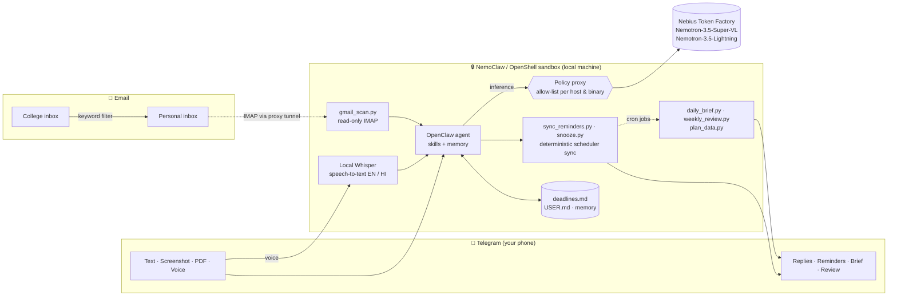

# 🛡️ Vigil — a private, always-on deadline guardian for students

**Personal AI track · Nebius × NVIDIA Global AI Hackathon**

Vigil watches everything that carries a deadline (WhatsApp screenshots, PDF circulars, college emails, voice notes in English or Hindi), turns it into **verified** reminders on your phone, and briefs you every morning. It runs inside an **NVIDIA NemoClaw / OpenShell sandbox** on your own machine, with **NVIDIA Nemotron** models served by **Nebius Token Factory**. There's no app to install: **Telegram is the interface**, so it works on any phone you already carry.

> 🎥 Demo video: `<https://youtube.com/shorts/6hcxr8znosg?si=cv0KvEtEgJxj-CWf>` · 👥 Team: `Rishi Bagodi, Sripad Mahesh, Srilakshmi`

---

## The problem
Indian college students get deadlines from everywhere: class WhatsApp groups, notice-board photos, PDF circulars, college email, hallway announcements. Nothing collects them, and missing one costs marks, fees or registrations. Existing assistants either can't read messy notices, or ask you to hand your whole inbox and life to a cloud service.

## What Vigil does
| You send / receive | Vigil does |
|---|---|
| 📝 A forwarded text notice | Extracts every deadline (date, time, type, source), saves it, schedules reminders |
| 📸 A screenshot or photo of a notice | Reads the image with **Nemotron-3.5-Super-VL** and does the same |
| 📄 A PDF circular | Reads the PDF and does the same |
| 📧 A college email | Scanned automatically at 7:30 AM and 6:30 PM (read-only); deadlines caught without you asking; silent when there's nothing new |
| 🎙️ A voice note: *"my viva is Friday at 10 AM"* | Transcribed **locally inside the sandbox** (English, or Hindi after `Hindi mode`), then handled like text |
| `remind me in 30 minutes to call the office` / `snooze` | One-off reminder or snooze, confirmed with the exact time |
| `plan my week` | A realistic 7-day study plan built around your deadlines, with prep spread ahead of heavy days |
| `what's due` / `done DBMS` / `brief` | Lists upcoming deadlines, completes items (and cancels their reminders), or gives the brief on demand |

**Automatic, every day:**
- ⏰ **Reminders** 24 h and 2 h before every deadline ("Done already? Reply 'done …'")
- ☀️ **Daily brief** at 7:55 AM: today / tomorrow / this week, Bengaluru weather, **⚠️ heavy-day warnings**, and a "🎯 Do first" suggestion
- 📊 **Weekly review** every Sunday 7 PM: done vs. not done, busiest day ahead, one suggestion


## Architecture



**Key idea: LLM for understanding, scripts for guarantees.** Nemotron reads notices, screenshots, PDFs, emails and voice transcripts and decides *what* the deadlines are. Deterministic Python scripts decide *when* things happen: `sync_reminders.py` makes the scheduler exactly match `deadlines.md`. It is idempotent (creates missing reminders, repairs wrong ones, removes stale or duplicate ones) and **verifies** the result before Vigil is allowed to say "Reminders set".

---

## How we use NVIDIA Nemotron + Nebius Token Factory

All inference goes to **Nebius Token Factory** (`https://api.tokenfactory.nebius.com/v1`, OpenAI-compatible) through the sandbox's policy proxy. The sandbox never holds the API key: the OpenShell gateway injects it.

| Task | Model (Token Factory ID) | Settings |
|---|---|---|
| Chat, screenshot & PDF reading, email extraction, plan my week | **`nvidia/Nemotron-3.5-Super-VL`** | main agent model; image input; maxTokens 16384, context 131072 |
| Reminders, snoozes, daily brief, weekly review | **`nvidia/Nemotron-3_5-Lightning`** | per-job `--model`, thinking off, light context, **read-only tools** |
| Scheduling, verification, sorting, stats | **No LLM** | deterministic Python scripts |

**Measured during development:**
- A reminder run on Lightning costs about **2,600 tokens**. The daily brief is about **20.7k tokens on Lightning vs ~35k on Super-VL** (the sandbox context dominates, so we also use `--light-context`).
- About **one hour of heavy end-to-end testing cost $0.18** of Token Factory credit.
- `enable_thinking: false` cut a simple call from **266 → 30 tokens (~9×)**. Nemotron reasons by default, so routine jobs run with thinking off.
- Disabling OpenClaw's default 30-minute heartbeat avoids **~1.2M tokens/day** of idle agent turns.
- OpenClaw's default **maxTokens of 4096** truncated multi-step Nemotron turns ("no final summary", tool calls cut off); **16384** fixed every case.
- Of the Nemotron models on Token Factory, only **Nemotron-3.5-Super-VL** accepts image input, so it is the main model.
- Compared with the free build.nvidia.com endpoint we prototyped on (intermittent HTTP 500s and timeouts), Token Factory replies were faster and consistent.

---

## Privacy & security model
- **Sandboxed agent.** Vigil runs in an NVIDIA OpenShell sandbox (Landlock, seccomp, network namespaces). Outbound traffic is **deny-by-default**; every allowed destination is listed per host, path and binary (see `docs/policy-snapshot.txt`). Asking Vigil to fetch an arbitrary website fails with HTTP 403.
- **Secrets stay out of the agent's prompts.** Inference and Tavily keys are injected by the gateway (`request_body_credential_rewrite`); the Telegram bot token is redacted in policy paths.
- **Only you can talk to it.** Telegram access is restricted to one user ID; group chats are disabled.
- **Voice never leaves the machine.** Voice notes are transcribed by faster-whisper (base.en for English, small for Hindi; int8 on CPU) **inside the sandbox**; only the text reaches the model.
- **Email is read-only and filtered.** IMAP `readonly` + `BODY.PEEK` (never sends, deletes, or marks mail read). A Gmail search filter means only mail addressed to the college account is read; the rest of the inbox never reaches the model.
- **Least privilege for scheduled jobs.** Reminder and snooze jobs run with `--tools read`, so a delivery-only run can't schedule, edit or execute anything.
- **The agent can't grant itself powers.** Scheduling scope required explicit owner approval via `openclaw devices`.
- **Honest limits:** the Gmail App Password is stored inside the sandbox (`chmod 600`, but readable by the agent while the file exists). Use a dedicated App Password and revoke it when done.

---

## Reliability (observed, not assumed)
- Reminders delivered unattended on time (e.g. 16:00, and two in parallel at 21:59).
- The 7:55 AM brief ran on its own; when the laptop was off, **missed jobs caught up** automatically on restart.
- Reminder sync is idempotent: re-running it changes nothing; duplicates and wrongly-routed jobs are repaired.
- Every scheduled job delivers **explicitly** to the owner's Telegram ID (never "last chat").
- The heartbeat is disabled in config as well as at runtime, so it stays off across gateway restarts.

---

## Setup (test build)

**Requirements:** Windows 10/11 with WSL2 (Ubuntu) + Docker Desktop, or Linux/macOS with Docker; 8 GB+ RAM; a Nebius Token Factory API key; a Telegram bot token (@BotFather) and your Telegram user ID (@userinfobot). Optional: a Gmail App Password. A step-by-step guide with troubleshooting is in [`docs/SETUP_GUIDE.pdf`](docs/SETUP_GUIDE.pdf).

### 1. Install NemoClaw and onboard
```bash
export NEMOCLAW_MAX_TOKENS=16384          # important: default 4096 truncates Nemotron
export NEMOCLAW_NO_EXPRESS=1              # choose the provider yourself
export COMPATIBLE_API_KEY="<token-factory-key>"
curl -fsSL https://www.nvidia.com/nemoclaw.sh | bash
```
Onboarding answers: agent **OpenClaw** → provider **Other OpenAI-compatible endpoint** → base URL `https://api.tokenfactory.nebius.com/v1` → model `nvidia/Nemotron-3.5-Super-VL` → sandbox name `vigil` → web search **Tavily** (optional) → messaging **Telegram** (toggle it *before* pressing Enter; bot token, your user ID, mention Y, groups `disabled`) → policy **Balanced**, plus presets **telegram, gmail, weather, local-memory** (again, toggle *before* Enter).

### 2. Install Vigil into the sandbox
```bash
alias vx='openshell sandbox exec --name vigil --'
git clone https://github.com/rishibagodi/NVIDIA-HACKATHON.git ~/vigil && cd ~/vigil
for d in skills tools scripts config; do nemoclaw vigil upload ./$d /sandbox/.openclaw/workspace/; done

# Whisper models for local voice notes (downloaded on the host, then uploaded)
vx mkdir -p /sandbox/.openclaw/vigil/models
for m in base.en small; do
  mkdir -p ~/vigil-models/whisper-$m
  for f in config.json model.bin tokenizer.json vocabulary.txt; do
    curl -sSL -o ~/vigil-models/whisper-$m/$f https://huggingface.co/Systran/faster-whisper-$m/resolve/main/$f
  done
  nemoclaw vigil upload ~/vigil-models/whisper-$m /sandbox/.openclaw/vigil/models/
done
```

### 3. Optional: Gmail (inside the sandbox: `nemoclaw vigil connect`)
Forward deadline-type college mail to a dedicated personal Gmail (Gmail filter → *Forward to*), create an App Password there, then:
```bash
mkdir -p /sandbox/.openclaw/vigil && chmod 700 /sandbox/.openclaw/vigil
read -p "Personal Gmail address: " E
read -s -p "App password (hidden): " P; echo
printf '{"email": "%s", "app_password": "%s", "filter": "(to:%s)"}\n' "$E" "${P// /}" "<college-address>" > /sandbox/.openclaw/vigil/gmail.json
chmod 600 /sandbox/.openclaw/vigil/gmail.json; unset P E
```

### 4. Configure jobs (inside the sandbox)
```bash
bash /sandbox/.openclaw/workspace/scripts/setup_jobs.sh <YOUR_TELEGRAM_ID>
cat /sandbox/.openclaw/workspace/config/AGENTS-additions.md >> /sandbox/.openclaw/workspace/AGENTS.md
```
`setup_jobs.sh` sets the model limits, disables the heartbeat permanently, installs faster-whisper, enables voice transcription, and creates the daily-brief, weekly-review and (if `gmail.json` exists) gmail-scan jobs. Then in Telegram send `/new`, and tell Vigil your timezone: *"My timezone is Asia/Kolkata. Save this in USER.md."*

### 5. Try it
Send `Exam Cell: Mini project demo on Wednesday. Hall ticket download closes Monday 6 PM.`, then try `what's due`, `brief`, `plan my week`, `remind me in 3 minutes to stretch`, a screenshot, a PDF, or a voice note (`Hindi mode` / `English mode` switches the voice language).

---

## Design decisions & lessons learned
1. **Verify, don't trust.** Early versions let the model create reminders itself. Testing showed it sometimes claimed reminders it hadn't created, created duplicates, or routed delivery to "last chat" (silently failing). A deterministic, verifying sync script fixed all three.
2. **Least privilege for automations.** Cron agent jobs default to *all* tools with skills loaded. A delivery-only "⏰ Reminder: stretch" run applied our snooze skill to its own message and re-scheduled itself every minute; "STOP" in chat couldn't stop it because the loop lived in cron runs. Every reminder job now runs with `--tools read`, and the sync script verifies that setting.
3. **Small models need explicit constraints.** Lightning echoed injected context ("Current time … UTC") and confused past with upcoming items until the prompt said so explicitly. Scripts compute the facts; the model adds one judgment line.
4. **Output budget matters with reasoning models.** The 4096-token default caused every truncation we saw.
5. **Defaults don't always persist.** The runtime heartbeat switch reset after a gateway restart; setting it in config (`every: 0m`, target `none`) made it stick.
6. **The sandbox shapes the engineering.** No direct DNS means raw-TCP clients need an HTTP CONNECT tunnel through the policy proxy (we built one for IMAP); per-binary policies meant downloading Whisper models on the host and uploading them.
7. **Let the user choose when detection is unreliable.** Whisper's language detection on short, accented clips was ~0.4–0.5 confidence, so the voice language is a one-word user setting instead of a guess.

Full developer feedback on Token Factory, NemoClaw, OpenShell and OpenClaw: see [`FEEDBACK.md`](FEEDBACK.md).

## Limitations & future work
- Runs on a laptop: if it sleeps, jobs catch up on wake. A Nebius VM would make it truly 24/7.
- Timezone (IST) and weather city (Bengaluru) are hard-coded for the demo.
- Voice: English and Hindi only, chosen manually; more Indian languages are future work.
- `plan my week` occasionally leaves out a low-priority item when the week is very full.
- **Future work: a web dashboard** (calendar view of deadlines, done/missed history) served from the sandbox behind the same policy model. We left it out of this build to keep the attack surface small.
- Single user by design (personal AI).

## Repository layout
```
skills/deadline-catcher/   SKILL.md, sync_reminders.py   (capture + verified reminders)
skills/snooze/             SKILL.md, snooze.py           (one-off reminders, read-only tools)
skills/plan-week/          SKILL.md, plan_data.py        (7-day study plan)
skills/daily-brief/        SKILL.md, daily_brief.py
skills/weekly-review/      SKILL.md, weekly_review.py
skills/gmail-scan/         SKILL.md, gmail_scan.py       (read-only IMAP through the proxy)
tools/transcribe.py        local speech-to-text (English / Hindi)
scripts/setup_jobs.sh      one-shot configuration inside the sandbox
config/                    AGENTS.md additions, gmail.json example
docs/                      policy snapshot
test*.py                   API smoke tests (Token Factory text + vision)
FEEDBACK.md                tool feedback log
```

## License
MIT. See [LICENSE](LICENSE).